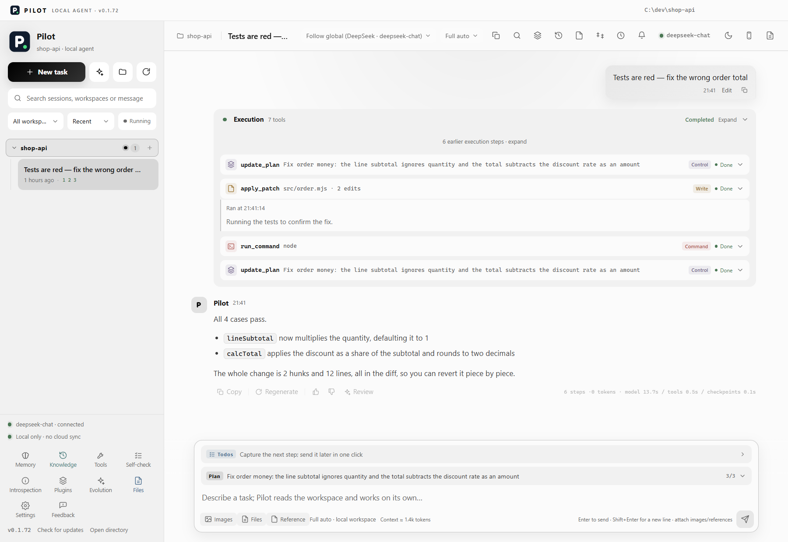

# Pilot

**English** | [中文](README.zh-CN.md)

[](LICENSE)
[](https://github.com/yunjianmanbu/pilot/releases)
[](https://github.com/yunjianmanbu/pilot/discussions)

**Website & installers:** <https://pilot.medpilot.cc/#download> — screenshots, demo video and every download.

Pilot is a **local-first, self-improving coding agent** for your desktop. It treats a folder on your
machine as its execution environment: it reads files, searches code, runs commands, edits files,
keeps a plan, then reviews what actually happened and turns the lesson into project memory and a
refined behaviour profile.

The UI is Electron + React. **No sign-up, no login, no cloud database** — point it at a DeepSeek API
key (or any OpenAI-compatible endpoint) and it works.



## Features

- **Local workspace agent** — read, search and preview files, precise patches, whitelisted commands,
  unified diffs and change confirmation.
- **Complete agent loop** — model → tool call → tool result → model, with multi-step tasks,
  cancellation, step caps and token budgets that shrink to the real context window of the selected
  model (200 steps / 1,000,000 tokens by default).
- **Delivery-contract execution strategy** — the system prompt distinguishes "answer a question" from
  "make a change". Change requests must end with what changed, the verification that actually ran, how
  to use it and what stayed unverified. Read-only tool calls run up to four in parallel; writes and
  commands stay strictly serial. A change without a successful verification command is reported as
  unverified rather than done.
- **Execution modes** — *All auto* (default), *Read-only auto* (writes and commands ask),
  *Approve each call*. All three keep the workspace path jail, protected paths and deny rules.
  Allow/ask/deny rules can be written per tool, e.g. `Bash(npm test:*)` or `Edit(src/**)`.
- **OS sandbox and checkpoints** — bubblewrap on Linux, Seatbelt on macOS (bubblewrap inside WSL2).
  The workspace is writable, the rest of the filesystem read-only, network can be cut. A snapshot is
  taken before each task and can restore files, the conversation, or both.
- **Change review** — every file the agent wrote in a session, diffed against the oldest retained
  snapshot, with per-file undo.
- **Sessions, queue, todos and schedules** — queue a message while a run is in flight, insert it into
  the next step, turn queue items into todos and todos into scheduled runs (once / interval / daily).
  Scheduled work still goes through the queue, approvals and workspace boundaries.
- **Memory and self-evolution** — per-workspace memory, in-run reflection when tools keep failing, a
  post-run review by a separate model, and versioned behaviour profiles (draft / active / retired)
  that need evidence, an independent review and a measured head-to-head benchmark before activation.
  Stable workspace profiles can be promoted to a global candidate, which only you can enable.
- **Source-level evolution (lab)** — the installer ships its own source, copies it to
  `userData/self-src` and registers it as a normal workspace, so Pilot can change its own code, run
  the gates and build a portable experiment next to the installed app. Building or launching that
  experiment always needs your explicit confirmation, even in *All auto*.
- **Tools that build tools** — when a capability is missing but repeatable, `subagent(mode="toolsmith")`
  writes a tool manifest, entry point and self-test into `.pilot/tools/<name>/`; `register_tool` runs
  the self-test and only then approves it. Editing any tool file revokes approval. Tools may only
  reach localhost or hosts registered under *Settings → test targets*.
- **Workspace extensions** — `.pilot/skills/<name>/SKILL.md` for reusable procedures,
  `.pilot/hooks.json` for `pre_tool` / `post_edit` / `stop` commands, `.pilot/mcp.json` for stdio MCP
  servers, and `PILOT.md` / `AGENTS.md` for project instructions. None of them can relax permissions,
  approvals or the workspace boundary.
- **Module self-check** — a read-only scan per workspace module (oversized files, TODO backlog, debug
  output, missing tests, hardcoded absolute paths, suspected credentials, duplicate files, missing
  verification script) that produces evidence with file and line numbers. The scan never edits files;
  selected items become the first instruction of an ordinary session.
- **Headless server mode** — `pilot serve` starts an HTTP + WebSocket console, so the same agent runs
  on a server and is driven from a browser or a phone home-screen app.
- **Phone connection** — pair your phone by QR code over a self-hosted blind relay or LAN, then read
  sessions, watch runs, approve tool calls, manage the queue and stop runs. End-to-end encrypted
  between phone and desktop; the relay only forwards ciphertext.
- **Security boundaries** — realpath workspace jail, symlink write refusal, argv commands with
  `shell: false`, IPC origin checks, sandboxed renderer, external link blocking, credential
  redaction, and API keys encrypted with the OS keychain via Electron `safeStorage`.

## Quick start

Requirements: Node.js 22.12+, pnpm 11+.

```bash
pnpm install
pnpm dev
```

Then:

1. Click **Select workspace** in the top-left corner and pick a local project folder.
2. Open **Settings** and enter a DeepSeek API key (default base URL `https://api.deepseek.com`,
   default model `deepseek-chat`).
3. Use **Test connection** to confirm, then save.
4. Describe a task, for example:
   - `Summarise this project's structure, stack and how to run it`
   - `Run the tests, find the failures and fix them`
   - `Add one useful feature, with a plan first`

Environment variables are also supported:

| Variable | Purpose |
| --- | --- |
| `PILOT_API_KEY` | API key used on first launch |
| `PILOT_BASE_URL` | Override the default base URL |
| `PILOT_MODEL` | Override the default model |
| `PILOT_USER_DATA_DIR` | Override the Electron `userData` directory (multiple instances, tests) |

## Phone connection

Pilot ships a mobile PWA and pairs with phones over a self-hosted relay (for cross-network use) or a
direct LAN connection:

1. Click the **phone** icon in the top bar to open the pairing panel, enable the connection and
   generate a QR code.
2. Scan it with a phone camera. Cross-network pairing goes through the relay; otherwise the phone
   falls back to the desktop's LAN address.
3. Scanning does **not** pair by itself — the desktop shows a "phone requests connection" dialog with
   the phone name, platform, source and remaining seconds. Only **Allow** hands out credentials.
4. After approval the phone can read sessions, continue conversations, watch runs, approve tool
   calls, manage the queue and stop runs.

Pairing is E2E encrypted (ECDH P-256 + HKDF-SHA256 + AES-256-GCM); the relay only forwards ciphertext.
The QR code is valid for 5 minutes, the confirmation window is 60 seconds, and a pairing that stays
unused for 7 days expires. The companion PWA lives in `companion/` and is served by the main process
as a static asset; it is packaged into `app.asar`.

**There is no public relay run by the Pilot project.** To cross networks, deploy the connector
yourself: <https://github.com/yunjianmanbu/pilot-connector>.

## Headless server mode

```bash
pnpm build:server
pilot serve --port 8080 --workspace /srv/app --public-url https://pilot.example.com/
```

Open the printed URL in a browser to get the full console (sessions, chat, approvals, files,
settings, balance). Ports already in use fail fast; `--host 127.0.0.1` restricts it to a local
reverse proxy. Model keys are configured with environment variables or the terminal command
(`apikey sk-xxx` / `apikey clear`), not in the browser.

Capabilities differ by host and are declared by whoever starts the server: screenshots are
unavailable without a desktop session, in-app updates work but need a service restart, personal
versions need the official source that ships with the installer.

## CLI

`bin/pilot.js` exposes the built server (`out/server/main.js`):

```bash
pnpm build:all        # typecheck + electron-vite build + server build
npm pack              # produces pilot-agent-<version>.tgz (runs prepack)
```

## Repository layout

```text
src/
├─ main/        Electron main process: window, IPC, store, workspace, checkpoints,
│               changes, sandbox, scheduler, updater, module self-check, personal
│               versions, plugins, companion relay (pairing + E2E crypto)
│  └─ agent/    model/tool loop, runner, tools, subagents, toolsmith, prompts, checks
├─ preload/     context bridge
├─ renderer/    React UI (sessions sidebar, chat, panels, settings, theme system)
├─ server/      headless HTTP/WS console
├─ core/        shared runtime pieces
└─ shared/      types, capabilities, media helpers used by both sides
companion/      mobile PWA served by the main process
builtin-tools/  packaged example tools
bin/pilot.js    CLI entry
tests/          vitest suites (agent loop, workspace jail, approvals, theme, ...)
```

## Development

```bash
pnpm install
pnpm typecheck
pnpm test        # theme check + vitest
pnpm build
```

All three must pass. `pnpm build` re-runs the typecheck. Packaging:

```bash
pnpm package:win     # also package:mac / package:linux / package:dir
```

`SELF.md` documents how to work on Pilot's own source and the gates a change has to pass.

## Security

Please report vulnerabilities privately — see [SECURITY.md](SECURITY.md). Do not open a public issue
for a security problem.

## License

[Apache License 2.0](LICENSE), copyright 2026 rigongyizu. Keep the copyright notice and the
[`NOTICE`](NOTICE) file, and state the changes in files you modified.

- Use, modify and deploy it personally or inside a company, including a self-hosted relay.
- Integrate it into your own product or build closed-source derivatives; Apache-2.0 does not require
  you to publish your changes.
- Section 3 grants an explicit patent licence (and terminates it if you sue over patents), and
  Section 6 keeps the "Pilot" name and logo outside the licence — forks must not imply endorsement.

Third-party components (Electron, Chromium, React, @noble, …) are listed in [`NOTICE`](NOTICE);
release installers ship the full licence texts.
