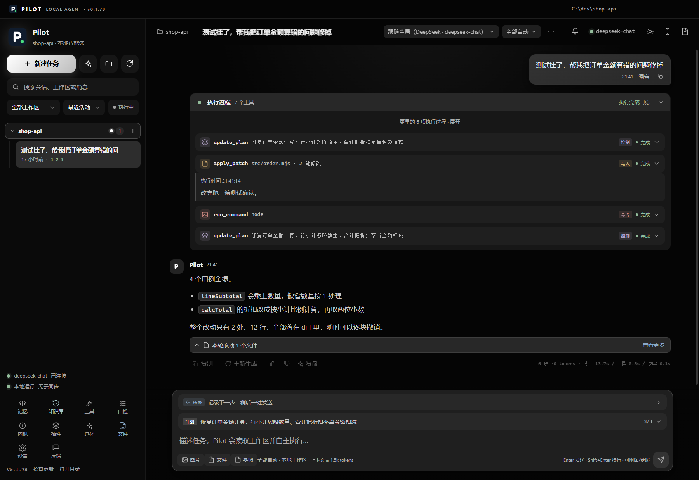

# Pilot

[English](README.md) | **中文**

**官网与下载：** <https://pilot.medpilot.cc/zh.html#download> —— 截图、演示视频与各平台安装包。

Pilot 是一个**本地优先**、可自我学习迭代的桌面编程智能体。它把你机器上的一个文件夹当作执行环境：
阅读文件、搜索代码、运行命令、修改文件、维护计划，并在真实运行之后复盘，把经验写进项目记忆、
把稳定的行为提炼成可回滚的行为画像。

界面由 Electron + React 构建，**无需注册、无需登录、无云端数据库**。填入 DeepSeek API Key
（或任意兼容 OpenAI 的端点）即可开始工作。



## 功能

- **本地工作区智能体**：读取 / 搜索 / 预览文件，精确 patch，执行白名单命令，统一 diff 与变更确认。
- **完整 Agent Loop**：模型 → 工具调用 → 工具结果 → 模型，支持多步任务、取消、步数与 token 预算，
  预算按所选模型的真实上下文窗口自动收敛（默认 200 步 / 1,000,000 token）。
- **交付契约式执行策略**：系统提示词区分「问答」和「改动」两种完成标准。改动类请求必须给出结果、
  实际运行的验证、使用方式和未验证项；没有成功运行验证命令就按「未验证」处理，而不是当作完成。
  只读工具调用最多 4 个并行，写入与命令始终串行。
- **三种执行模式**：全部自动（默认）、只读自动（写入与命令询问）、逐条审批。三者都保留工作区路径牢笼、
  受保护路径与拒绝规则；允许 / 询问 / 拒绝规则可按工具写，例如 `Bash(npm test:*)`、`Edit(src/**)`。
- **OS 沙箱与回退点**：Linux bubblewrap、macOS Seatbelt（WSL2 内为 bubblewrap）。工作区可写、
  其余文件系统只读、可断网；每次任务前自动快照，可分别回退文件、对话或两者。
- **变更审阅**：按会话汇总智能体写入的文件，与会话最早的保留快照做统一 diff，支持逐文件撤销。
- **会话 / 队列 / 待办 / 定时互通**：执行中可继续输入并选择排队或插入下一步；排队项可转待办，
  待办可转定时任务（一次 / 间隔 / 每天）。定时任务同样走队列、审批与工作区边界。
- **记忆与自我进化**：每工作区独立记忆；工具连续报错时运行内反思，运行结束后由独立模型复盘；
  行为画像是版本化的（draft / active / retired），需要证据、独立评审与实测基准才能启用。
  稳定的工作区画像可提升为全局候选，但只有你能启用。
- **源码级进化（实验室）**：安装包自带源码，首次使用时复制到 `userData/self-src` 并注册为普通工作区，
  Pilot 可以改自己的代码、跑门禁并构建独立运行的实验版；构建或启动实验版始终需要你确认，
  即使当前是「全部自动」。
- **会造工具的智能体**：遇到缺失但会反复用到的能力时，`subagent(mode="toolsmith")` 在
  `.pilot/tools/<name>/` 写清单、入口和自测，`register_tool` 跑通自测才批准；改动任何工具文件即撤销批准。
  工具运行时只能访问 localhost 或「设置 → 测试目标」里登记的地址。
- **工作区扩展**：`.pilot/skills/<name>/SKILL.md` 存可复用流程，`.pilot/hooks.json` 配
  `pre_tool` / `post_edit` / `stop`，`.pilot/mcp.json` 启动 stdio MCP 服务器，`PILOT.md` / `AGENTS.md`
  提供项目指令。它们都不能放宽权限、审批或工作区边界。
- **模块自检**：按工作区顶层目录只读扫描（超大文件、TODO 积压、调试输出、缺测试、硬编码绝对路径、
  疑似凭据、重复文件、缺验证脚本），给出文件与行号证据。扫描绝不改文件；勾选后的条目会变成一个
  普通会话的首条指令。
- **服务器模式**：`pilot serve` 启动 HTTP + WebSocket 控制台，同一个智能体可以跑在服务器上，
  用浏览器或手机「添加到主屏幕」当应用用。
- **手机连接**：扫码配对（自建盲中继跨网络，或局域网直连），在手机上查看会话、观察执行过程、
  审批工具调用、管理队列、停止运行。手机与电脑端到端加密，中继只转发密文。
- **安全边界**：realpath 工作区牢笼、拒绝符号链接写入、命令以 argv 执行（`shell: false`）、
  IPC 来源校验、沙箱渲染进程、外链拦截、凭据脱敏、API Key 经 Electron `safeStorage` 加密保存。

## 快速开始

环境要求：Node.js 22.12+、pnpm 11+。

```bash
pnpm install
pnpm dev
```

启动后：

1. 点左上角 **选择工作区**，选一个本地项目文件夹。
2. 打开 **设置**，填入 DeepSeek API Key（默认 Base URL `https://api.deepseek.com`，
   默认模型 `deepseek-chat`）。
3. 点 **测试连接** 确认可用，保存。
4. 描述任务即可，例如：
   - `先梳理一下这个项目的结构、技术栈和启动方式`
   - `运行项目测试，定位并修复失败项`
   - `为这个项目添加一个实用的新功能，先给出计划再实施`

也可以用环境变量：

| 变量 | 作用 |
| --- | --- |
| `PILOT_API_KEY` | 首次启动时作为 API Key |
| `PILOT_BASE_URL` | 覆盖默认 Base URL |
| `PILOT_MODEL` | 覆盖默认模型 |
| `PILOT_USER_DATA_DIR` | 覆盖 Electron userData 目录（多实例 / 测试） |

## 手机连接

Pilot 自带手机 PWA，可用自建中继跨网络连接，也可在同一局域网直连：

1. 点顶栏 **手机图标**，开启连接并 **生成二维码**。
2. 用手机相机扫码。配置了自建中继就走中继，否则回退到电脑的局域网地址。
3. **扫描本身不会配对**：电脑会弹出「手机请求连接这台电脑」，显示手机名称、平台、来源和剩余秒数，
   点 **允许连接** 后手机才拿到凭证。
4. 允许之后可以查看会话、继续对话、观察执行过程、审批工具、管理队列、停止任务。

配对使用 ECDH P-256 + HKDF-SHA256 + AES-256-GCM 端到端加密，中继只转发密文。二维码 5 分钟有效，
确认等待 60 秒，配对成功后连续 7 天未连接自动失效。手机端源码在 `companion/`，由主进程作为静态资源
提供，打包时一起进入 `app.asar`。

**Pilot 官方不提供公共中继服务。** 需要跨网络时请自行部署连接器：
<https://github.com/yunjianmanbu/pilot-connector>。

## 服务器模式

```bash
pnpm build:server
pilot serve --port 8080 --workspace /srv/app --public-url https://pilot.example.com/
```

在浏览器打开终端打印的地址即进入完整控制台（会话、对话、审批、文件、设置、余额）。端口被占用会直接
报错退出，`--host 127.0.0.1` 可只允许本机反向代理访问。模型密钥不在这里填，用环境变量或终端命令
（`apikey sk-xxx` / `apikey clear`）配置。

不同宿主能做什么由启动方声明：没有桌面会话就没有截图类工具；应用内更新可用但要重启服务；
个人版本需要安装包自带的官方源码。

## CLI

`bin/pilot.js` 是构建后服务端的入口（`out/server/main.js`）：

```bash
pnpm build:all        # typecheck + electron-vite build + server build
npm pack              # 生成 pilot-agent-<version>.tgz（会先跑 prepack）
```

## 目录

```text
src/
├─ main/        Electron 主进程：窗口、IPC、存储、工作区、回退点、变更、沙箱、定时、
│               更新、模块自检、个人版本、插件、手机中继（配对 + 端到端加密）
│  └─ agent/    模型/工具循环、运行调度、工具、子智能体、造工具、提示词、检查
├─ preload/     context bridge
├─ renderer/    React 界面（会话侧栏、对话、面板、设置、主题体系）
├─ server/      无界面 HTTP/WS 控制台
├─ core/        共享运行时部件
└─ shared/      两端共用的类型、能力声明、媒体处理
companion/      主进程托管的手机 PWA
builtin-tools/  随包分发的示例工具
bin/pilot.js    CLI 入口
tests/          vitest 套件（Agent 循环、工作区牢笼、审批、主题等）
```

## 开发

```bash
pnpm install
pnpm typecheck
pnpm test        # 主题检查 + vitest
pnpm build
```

三条都必须通过，`pnpm build` 会再跑一次 typecheck。打包：

```bash
pnpm package:win     # 另有 package:mac / package:linux / package:dir
```

改 Pilot 自身源码时的约定和门禁见 [`SELF.md`](SELF.md)。

## 安全

漏洞请私下报告，见 [`SECURITY.md`](SECURITY.md)；安全问题不要开公开 issue。

## 许可

[Apache License 2.0](LICENSE)，版权归 2026 rigongyizu。你需要保留版权声明与 [`NOTICE`](NOTICE)
文件，并在修改过的文件里注明改动。

- 个人或公司内部自由使用、修改、部署（含自建中继）；
- 可以集成进你自己的产品，或基于它做闭源二次开发，Apache-2.0 不要求你开源自己的改动；
- 第 3 条给出明确的专利授权（就本项目发起专利诉讼则授权终止），第 6 条把「Pilot」名称与 Logo
  排除在授权之外，修改版不得暗示官方背书。

第三方组件（Electron、Chromium、React、@noble 等）的许可见 [`NOTICE`](NOTICE)，
安装包内随包分发完整许可文本。
